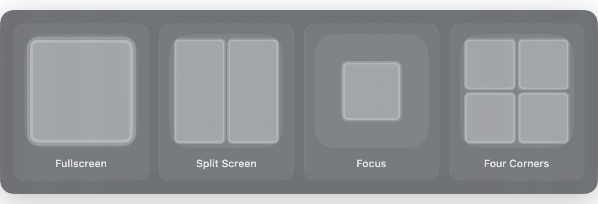
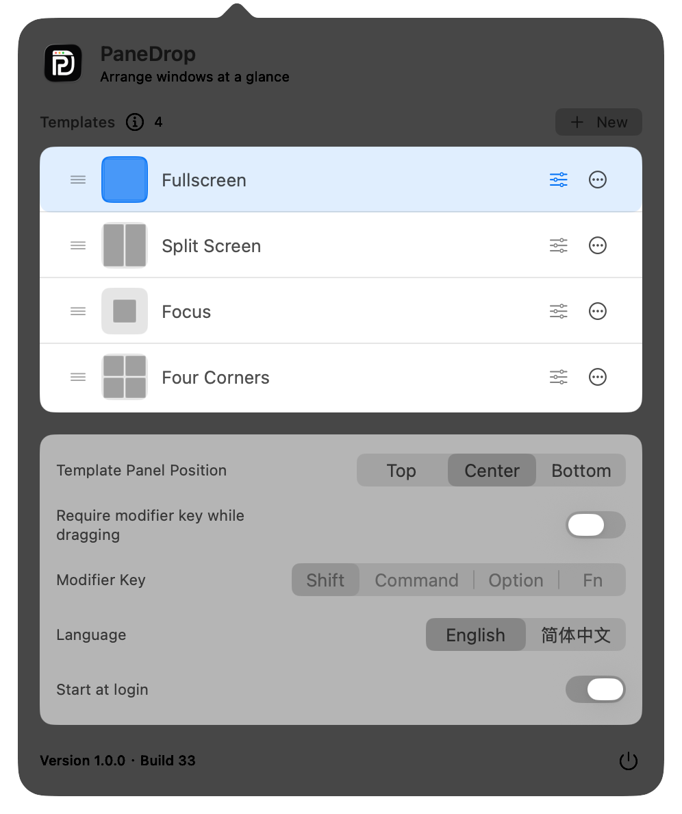

<p align="center">
  
</p>

<h1 align="center">PaneDrop</h1>

<p align="center">
  Drag a window. Choose a template. Drop it into place.
</p>

PaneDrop is a lightweight macOS menu bar app for visual window placement. While you drag a window, it displays your templates and their zones. Release the pointer over a zone to move and resize the window.

<p align="center">
  
</p>

## Features

- Shows a visual template panel while a window is being dragged.
- Follows the active display for multi-monitor window placement.
- Includes Fullscreen, Split Screen, Focus, and Four Corners templates.
- Supports custom templates with freely positioned and resized zones.
- Creates, renames, duplicates, reorders, and deletes templates.
- Wraps large template collections across centered rows.
- Places the template panel at the top, center, or bottom of the display.
- Optionally requires Shift, Command, Option, or Fn while dragging. This is disabled by default.
- Switches the interface between English and Simplified Chinese from the menu bar settings.
- Supports starting PaneDrop automatically at login on macOS 13 or later.
- Exports and imports preferences and templates as a portable JSON settings file.

<p align="center">
  
</p>

## How to use PaneDrop

1. Finish the three setup requirements shown on first launch.
2. Drag an app window by its title bar.
3. Move the pointer over a zone in the template panel.
4. Release the pointer to move and resize the window.

To require a modifier key, enable **Require modifier key while dragging** in the menu bar settings and choose Shift, Command, Option, or Fn.

## Templates

| Built-in template | Result |
| --- | --- |
| Fullscreen | Uses the entire available screen area |
| Split Screen | Places the window in the left or right half |
| Focus | Centers the window at 60% width and 60% height |
| Four Corners | Places the window in a 50% × 50% corner |

Select **New** to open **Edit Template** with the template name ready to edit. The same editor can rename a template, add or remove zones, apply zone presets, and adjust zone position and size by dragging.

Template names are limited to 32 characters and must be unique. A duplicated template uses `Copy`, `Copy 2`, and the next available number without changing the original.

## Settings backup and future sync

Use **Export Settings** in the menu bar settings to save the current preferences, template order, selected template, and zone definitions. **Import Settings** validates the file before replacing the current configuration.

The exported JSON archive has an explicit format version and stable identifiers for templates and zones. This keeps local backups readable and provides the data-model foundation for a future settings synchronization service.

## Setup and permissions

PaneDrop checks its setup status every time it launches. If any requirement is incomplete, the Setup window opens. Clicking the menu bar icon returns to Setup until all three items are ready.

| Requirement | Why it is needed |
| --- | --- |
| Accessibility | Detects the window being dragged and its current geometry |
| Window control script | Moves and resizes the selected window through System Events |
| Automation | Allows PaneDrop to run the installed script with System Events |

When all three items become ready, Setup closes automatically and the menu bar settings open.

### Window control script installation

PaneDrop runs in the App Sandbox. To install the bundled window control script, it asks the user to select PaneDrop's folder inside `~/Library/Application Scripts`, then copies the script with explicit user permission. The installed script runs with `NSUserAppleScriptTask`.

If macOS asks for permission again after installing a newly signed build, open **System Settings → Privacy & Security** and verify Accessibility and Automation access.

## Requirements

- macOS 12.0 or later
- Accessibility access
- The bundled window control script installed
- Automation access for System Events

## Development

Open `PaneDrop.xcodeproj` in Xcode and run the shared `PaneDrop` scheme. Debug and Release builds use the same sandboxed application behavior.

Command-line builds:

```sh
xcodebuild -project PaneDrop.xcodeproj \
  -scheme PaneDrop \
  -configuration Release \
  build
```

An Apple Developer team and the appropriate signing certificates must be configured before archiving or distributing the app.

## Project structure

| File | Responsibility |
| --- | --- |
| `App.swift` | Application lifecycle, setup routing, and menu bar item |
| `WindowDrag.swift` | Window-drag and modifier-key detection |
| `Switcher.swift` | Template panel, wrapping, and zone hover state |
| `ZoneEditor.swift` | Template naming and visual zone editing |
| `WindowAutomation.swift` | Permission checks, script installation, and window control |
| `UserData.swift` | Templates, stable identifiers, validation, ordering, and local persistence |
| `Settings.swift` | Preferences and versioned settings import/export |

## Privacy

PaneDrop does not include analytics, telemetry, advertising, or network requests. Window information, templates, and preferences stay on the Mac.

The current version and build number are shown in the bottom-left corner of the menu bar settings. Debug builds reuse the latest local build number without changing the repository. A Release archive atomically increments the counter stored under `~/Library/Application Support/DavidLabWorks/PaneDropBuild/BuildNumber.txt` and writes it into the archived app. `CURRENT_PROJECT_VERSION` is the tracked initialization baseline for a new development Mac.
